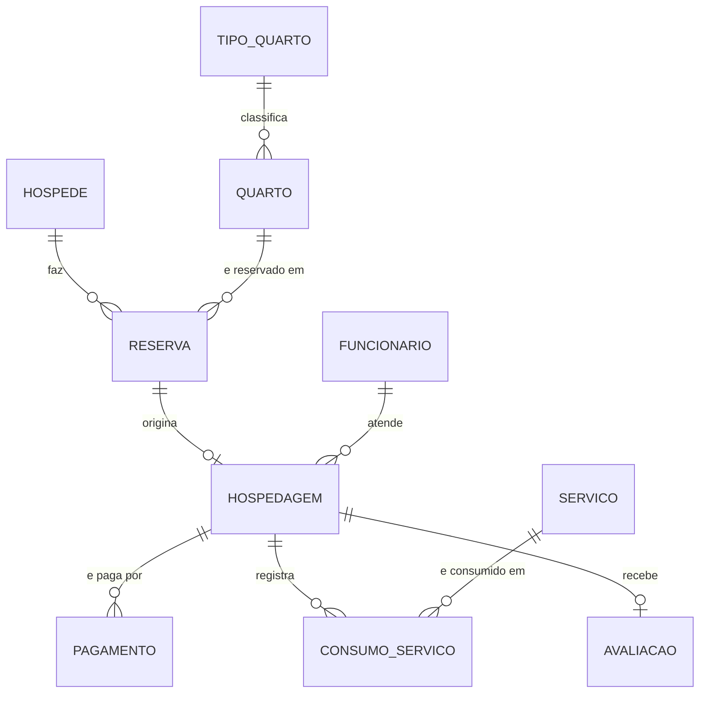

# Parte 1 - Origem do Sistema

## 1. Entidades e atributos

| Entidade | Descrição | Principais atributos |
|----------|-----------|----------------------|
| **Hóspede** | Cliente que reserva e se hospeda | id, nome, cpf, email, telefone, data de nascimento, cidade |
| **Tipo de quarto** | Categoria do quarto (Standard, Executivo, Luxo) | id, nome, descrição, capacidade, preço da diária |
| **Quarto** | Unidade física do hotel | id, número, andar, status (ativo/manutenção) |
| **Funcionário** | Profissional do hotel | id, nome, cpf, cargo, email, data de admissão, ativo |
| **Reserva** | Pedido de um hóspede para um quarto em um período | id, datas de reserva/check-in/check-out, status, data de cancelamento |
| **Hospedagem** | Estadia real, que nasce de uma reserva confirmada | id, check-in real, check-out real, status |
| **Pagamento** | Valor pago por uma hospedagem | id, valor, forma de pagamento, data, status |
| **Serviço** | Serviço extra oferecido (café, spa, lavanderia...) | id, nome, preço |
| **Consumo de serviço** | Registro de um serviço usado em uma hospedagem | id, quantidade, valor unitário, data |
| **Avaliação** | Nota e comentário do hóspede sobre a estadia | id, nota (1 a 5), comentário, data |

## 2. Relacionamentos

| Relacionamento | Cardinalidade | Explicação |
|----------------|---------------|------------|
| Hóspede **faz** Reserva | 1 : N | Um hóspede faz várias reservas; cada reserva é de um hóspede |
| Quarto **é reservado em** Reserva | 1 : N | Um quarto aparece em várias reservas (em períodos diferentes) |
| Tipo de quarto **classifica** Quarto | 1 : N | Um tipo agrupa vários quartos |
| Reserva **origina** Hospedagem | 1 : 0..1 | Uma reserva gera no máximo uma hospedagem (canceladas não geram) |
| Funcionário **atende** Hospedagem | 1 : N | O profissional responsável pelo check-in atende várias hospedagens |
| Hospedagem **é paga por** Pagamento | 1 : N | Uma hospedagem pode ser paga em mais de um pagamento |
| Hospedagem **registra** Consumo de serviço | 1 : N | Uma hospedagem consome vários serviços |
| Serviço **é consumido em** Consumo de serviço | 1 : N | Um serviço aparece em vários consumos |
| Hospedagem **recebe** Avaliação | 1 : 0..1 | Cada hospedagem pode ter uma avaliação |

Observação: Serviço e Hospedagem têm relacionamento **N:N**, resolvido pela tabela associativa `consumo_servico`.

## 3. Regras de negócio

1. O CPF e o e-mail de hóspedes e funcionários não podem se repetir.
2. A data de check-out deve ser posterior à data de check-in.
3. Um quarto não pode ter duas reservas não canceladas com datas sobrepostas (verificada na consulta de disponibilidade; em uma API futura, na regra da aplicação).
4. Quartos em manutenção não podem ser reservados.
5. Reserva cancelada deve ter data de cancelamento, e reserva não cancelada não pode ter.
6. Só reservas não canceladas geram hospedagem, e cada reserva gera no máximo uma.
7. Toda hospedagem tem um funcionário responsável pelo atendimento.
8. Valores de pagamento, preços e quantidades devem ser maiores que zero.
9. A nota da avaliação vai de 1 a 5, e cada hospedagem tem no máximo uma avaliação.
10. O consumo guarda o valor unitário do momento, para que mudanças futuras no preço do serviço não alterem o histórico.

## 4. Modelo lógico relacional

(PK = chave primária, FK = chave estrangeira)

- **hospede**(id_hospede PK, nome, cpf, email, telefone, data_nascimento, cidade, data_cadastro)
- **tipo_quarto**(id_tipo_quarto PK, nome, descricao, capacidade, preco_diaria)
- **quarto**(id_quarto PK, numero, andar, status, id_tipo_quarto FK -> tipo_quarto)
- **funcionario**(id_funcionario PK, nome, cpf, cargo, email, data_admissao, ativo)
- **reserva**(id_reserva PK, id_hospede FK -> hospede, id_quarto FK -> quarto, data_reserva, data_checkin, data_checkout, status, data_cancelamento)
- **hospedagem**(id_hospedagem PK, id_reserva FK UNIQUE -> reserva, id_funcionario FK -> funcionario, checkin_real, checkout_real, status)
- **pagamento**(id_pagamento PK, id_hospedagem FK -> hospedagem, valor, forma_pagamento, data_pagamento, status)
- **servico**(id_servico PK, nome, preco)
- **consumo_servico**(id_consumo PK, id_hospedagem FK -> hospedagem, id_servico FK -> servico, quantidade, valor_unitario, data_consumo)
- **avaliacao**(id_avaliacao PK, id_hospedagem FK UNIQUE -> hospedagem, nota, comentario, data_avaliacao)

## 5. Diagrama ER

Imagem: `diagrama-er.png` (nesta pasta). O mesmo diagrama em Mermaid aparece desenhado direto no GitHub:

